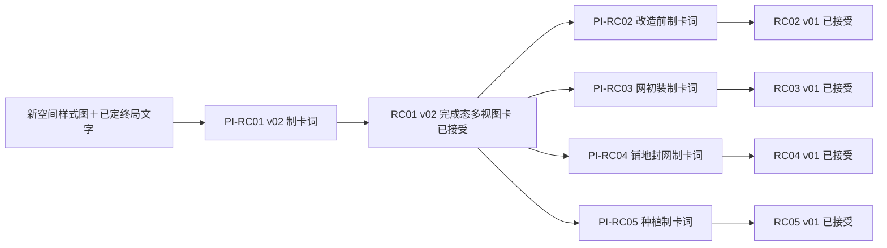
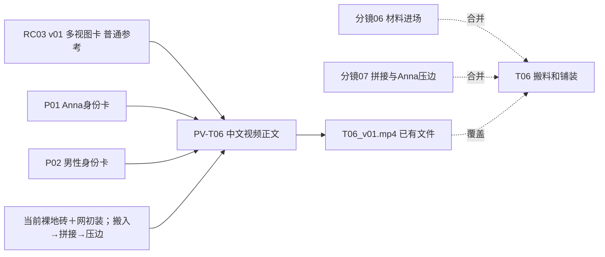

# 鸽子阳台实战：多视图参考卡直接生视频

这是一份依据 2026-09-14 实际项目复原的完整操作样品，普通组取 T06；T12 用于说明局部失败边界。它不接管原项目台账，也不要求重做已接受素材。新项目复用方法和写法，替换成自己的分镜、设计、路径和工具设置即可，不依赖本文历史路径运行。

## 证据与边界

- **用户实战反馈：**“今天用这个方式，就是参考多个参考图的方式去测试生成视频的整个流程，提速了特别多特别多……充分是一个成功的方法”。来源：主任务“当前skill流程”，`codex://threads/01a08e0d-8dfb-72c2-ac4e-9fa0c9e85383`；原话亦保存在 `C:/Users/Administrator/work/视频Skill升级_多视图参考卡实战成功_交接.md` 第 1 节。
- **已核验文件事实：**实战目录有 RC01 v02、RC02–RC05、两张人物卡及 T06_v01.mp4 等多段视频。用户在制图任务明确“图片都做完了，你不用看，我审核过了”。本次只查路径和文字记录，没有复审这些媒体。
- **已验证到的范围：**本用户已实践多参考输入并确认总体显著提速，足以升级其默认生产策略。T06 文件存在不等于已核验该文件恰由下列逐字提示词或精确参数生成，也不等于有 T06 单条完整验收结论。
- **仍未知：**精确省时倍数、13 组全部通过、最终剪辑质量、跨模型泛化效果。文件夹虽已有带发布标题的视频，也不能据此推定已发布或最终版本通过。

## 全局关系：15 个小分镜如何成为今天的 13 组

终局：同一普通窄阳台，免打孔可拆防鸟网把鸽子留在外面；地面干净可走、两人有座位、花箱不堵通道，Anna 重新安心使用。当前视觉版是烟灰蓝网、黑撑杆/绑带、灰色小方格地板。颜色和家具是这个项目的选择，不是所有阳台的统一规格。

| 原小分镜 | 已定生产组 | 必需场景卡 | 人物普通参考 |
|---|---|---|---|
| 01；02；03+04；05前半 | T01；T02；T03；T04 | RC02 v01 改造前 | T01 仅 P01；其余 P01+P02 |
| 05后半；06+07 | T05；T06 | RC03 v01 清理后网初装 | P01+P02 |
| 08；09 | T07；T08 | RC04 v01 铺地/网收紧 | P01+P02 |
| 10+11；12 | T09；T10 | RC05 v01 种植中 | P01+P02 |
| 13；14；15 | T11；T12；T13 | RC01 v02 完成态 | T11/T12 仅 P01；T13 P01+P02 |

13 组是本项目已定安排，不是新项目的固定数量。下图为共享卡制作层；卡均已存在，所以现在无需执行图中历史制卡操作。



备用读法：样式图＋终局设计→PI-RC01→RC01；RC01 分别经 PI-RC02/03/04/05 生成四张阶段卡。四条制卡线不彼此等待。视频层是“各组上述场景卡＋所需人物卡＋当前动作文字→本组 PV→本组视频”，没有前片尾帧串行链。

台账早期曾写 RC04 服务 T06–T08；更晚的独立输入表和生产正文已限定：T06 必传 RC03，RC04 仅可选目标样式。本文沿后者。原小分镜的旧 U01–U22 候选及“网几乎隐形”不恢复。原文件与后来台账部分成片秒数有差异；本样品保留 06+07 动作和约 41 秒总目标，不自行重排今天全片时间。

## T06 完整中文生产卡

**当前任务：**把材料搬入、实际拼接、Anna 压边合成一个自然生产单元；可在素材内部从中景硬切到手部。两人协作让旧脏区逐步成为可走区域，不能用完成地板摆拍替代过程。

**前后关系：**T05 后的清理/网初装阶段→本组铺地→T07 收紧网边。叙事先后用于剪辑，不要求 T06 等 T05 尾帧；T07 也不等 T06 尾帧。

**唯一项目台账：**`E:/智线出海内容运营/13_内容复盘/YouTube/我的频道全套数据/06_制作对话与决策/20260914_鸽子欧美阳台/实验台账_当前.md`。本卡是本次升级的证据快照，不是项目新增台账。旧台账含未更新的“全部未生成”字样，当前文件与后续用户消息已覆盖该状态，不能照抄。

### 逐线关系



备用读法：06+07 归入 T06；RC03＋P01＋P02＋当前阶段和动作要求→PV-T06→T06 视频。已有参考卡直接进视频步骤，无本段待造首帧。

### 上传这三张普通参考

| 顺序/身份 | 实际绝对路径 | 用途与状态 |
|---|---|---|
| 1 / RC03 v01 | `E:/智线出海内容运营/13_内容复盘/YouTube/我的频道全套数据/06_制作对话与决策/20260914_鸽子欧美阳台/RC03_清理后网初装态多视图卡_v01.png` | 当前同一空间、清理后裸地砖、初装微松的网；已存在、用户接受 |
| 2 / P01 当前真源 | `E:/智线出海内容运营/13_内容复盘/YouTube/我的频道全套数据/06_制作对话与决策/20260914_鸽子欧美阳台/人物_Anna_完整卡_当前真源.png` | 只借 Anna 脸、体型和服装身份；已存在、用户接受 |
| 3 / P02 当前真源 | `E:/智线出海内容运营/13_内容复盘/YouTube/我的频道全套数据/06_制作对话与决策/20260914_鸽子欧美阳台/亚洲男性三视图.png` | 只借男性身份；已存在、用户接受 |

RC01 不传；RC04 不需要传，灰色小方格地板目标由正文说明，避免目标画面抢成开头。卡面多视图、编号、中文标签是参考信息，不是要求视频分屏，也不是网站 API 槽位名。

**设置与实际操作：**沿用户已实际使用的网站普通多参考方式，把以上三图按序上传，复制下面全文。目标为 9:16、无对白；原制作说明建议 6 秒素材。6 秒是建议，当前记录没有网站模型名称、精确时长档位、图数上限、独立首帧槽位的已核实值，也没有本文件实际生成时长记录。原组已生成，无需因此重做。若在新环境重跑，只补读或集中询问缺失设置；不为补参数重新问剧情或重审图片。

### 可复制视频正文

以下复原最新生产对话 T06 正文，未把本次改写冒充一次新增生成成功。

```text
生成一条单一全屏、9:16 竖屏的生活真实感阳台记录视频。

第一张多视图参考图只用于同一处清理后阳台的当前状态：旧地砖仍裸露，烟灰蓝防鸟网只是初步挂起且尚未最终收紧。不要生成分屏、卡片、标签、编号、字幕或文字。第二张图只用于 Anna 身份；第三张图只用于男性身份。

开头，男性从室内门口搬入数块灰色小方格可拆卸拼接地板，阳台地面仍是旧地砖。前段，他把拼接地板材料放到阳台内，Anna 在侧边递给他下一块或帮他移开小物件。中段，男性从门口一侧开始，真实地把灰色小方格拼接地板一块块对齐、卡入、按平，旧地砖逐渐被覆盖。后段，Anna 半蹲或弯腰，用手掌压住一条拼接边缘，男性继续调整相邻地板接缝，地面形成整齐可走的局部区域。

镜头从中景搬料开始，自然切到略高角度看手部拼接和 Anna 压边；可以有一次内部硬切，但空间必须是同一阳台。网仍为初装状态，不能提前变成最终收紧。保留材料搬运、地板卡扣、手掌压边和脚步声。无对白、无字幕，不出现花箱、植物或完成态家具。
```

**保存：**历史结果 `E:/智线出海内容运营/13_内容复盘/YouTube/我的频道全套数据/06_制作对话与决策/20260914_鸽子欧美阳台/T06_v01.mp4` 已存在。真需重跑时新候选可命名该目录 `T06_v02.mp4`，先查重；不覆盖 v01，不把新候选自动记成接受。

**选段：**保留材料进场、至少两块真实拼接、Anna 压边三个可读动作。原来源 06+07 属于约 10.22–15.14 秒的搬料铺装区间；台账曾建议实际取 3–4 秒，最终按当前剪辑余量选段。6 秒素材不等于成片必须占 6 秒。不能靠删掉协作或把地板瞬移来压时长。

**异常只处理本组：**若完成地板抢成开头，检查是否误传 RC04，先去掉冲突目标输入，并明确裸地先出现；若手部拼接缺失，保留搬料有效部分，只补对齐卡扣和压边；若 Anna 未出现，保留可用男性铺装片段，只补协作动作。只有已知关键几何/姿态缺口时才补局部构图或单幅首帧，不重做全套 RC。

**结果与下一步：**T06 文件存在、总体方法获用户肯定；本次未看其画面、未补造单条成功数据。实际项目继续用已有素材；新项目按上述卡片方式准备一组，并让用户直接在自己网站执行，无需 AI 额外质量放行。

### RC03 怎么做出来：已有图无需重做

供新项目理解制卡路径的历史示范。来源是制图任务的 RC03 完整正文；输入为同项目 `RC01_完成态共同空间母卡_v02.png`，只借建筑关系，不传人物或旧阳台图。输出是上述 RC03 路径，后由用户确认“审核了，没有问题”。卡的四视图是本次设计，不是固定格数；卡画幅按可读性和实际工具选择，不由 9:16 视频强制。

```text
基于参考图中的同一栋欧洲普通公寓阳台，生成一张“清理后、防鸟网刚开始安装”的多视图真实参考卡。

必须保持同一暖沙色灰泥墙、深色法式门、黑色细铁艺栏杆、顶棚、窄长尺度、对面城市住宅背景和灰色小方格地面。

这是清理完成、铺地尚未开始的阶段：旧地砖已经被清洁干净，没有鸽子、羽毛、污染椅垫或新花箱；地面仍是干净的旧灰色小方格地砖，没有新拼接地板。两把完成态椅子和小圆桌还没有归位。

防鸟网采用免打孔、可拆卸安装：阳台开口两侧有两根极细的哑光黑色伸缩撑杆，从地面顶到顶棚；低饱和烟灰蓝细密尼龙网刚刚挂起，用可拆卸黑色绑带固定在栏杆和撑杆上。网已经看得见，但仍有一处边缘稍微松弛，尚未最终收紧。不要出现钻孔、螺丝、膨胀螺栓、胶水残留、白色扎带或厚重金属框架。

卡片顶部留白处写“RC03｜清理后、网初装的同一阳台”。用细白色留白分成四个真实摄影视图，每个分区下方留白处写：
“A｜清理后的整体施工状态”
“B｜反向视角：门、栏杆与工具”
“C｜免打孔网初装细节”
“D｜干净旧地砖与未铺地走道”

A 区最大：从门口向外拍，清楚看到干净旧地砖、初步挂起的烟灰蓝网、两侧黑色伸缩撑杆和少量清洁工具。
B 区：从栏杆侧向室内拍，看见法式门、黑色栏杆、工具和刚挂起的网面。
C 区：近景展示一根黑色伸缩撑杆、烟灰蓝网边和可拆卸黑色绑带，明确表现无打孔安装，网边尚未完全拉紧。
D 区：低角度展示干净旧灰色小方格地砖、门口到栏杆的空走道，证明新地板还没有铺上。

四个视图必须是同一阳台、同一施工阶段，只是角度不同。不要出现人物、鸽子、文字以外的标志、豪宅露台、酒店风或夸张施工场面。除卡名和 A/B/C/D 短标签外，不要其他文字。自然傍晚日光，普通城市公寓真实手机摄影质感。
```

## T12：局部失败不抹掉总体提速

**已核验用户报告：**先出现鸽子从阳台里面向外飞；改文字后用户仍说：“鸽子在阳台里面了，人在阳台外面浇花了，错大发了。”来源是最新制作任务两轮反馈，见下方任务与消息编号。

**判断而非已证实根因：**当前参考和机位未能稳定表达网内外，值得改变局部构图；仅凭两次失败不能断言某一个因素是唯一根因，更不能说换机位后模型“没法翻转”。

**当时提出的最小修复：**只补 T12 的网外斜侧构图图，必要时在已确认支持的首帧模式中使用；相机和鸽子位于网外开放侧，网面斜穿中间，Anna 双脚踩阳台地板，法式门在她身后，花箱与她都在网内。视频固定同侧机位，鸽子在网外靠近、转向飞离，Anna 继续浇花。不要凭空设计网外落脚平台。

```text
RC01 v02（完成建筑）＋P01（Anna）＋上述几何要求
  → PI-T12-G01（局部构图词，待需要时实例化）
  → T12-G01（计划补图，制作/采用未确认）
  → PV-T12 修订（输入位置按真实工具）→ T12 新候选视频
```

**状态：**已经提出补图/首帧修复思路和修订视频正文；补图是否制作、是否实际采用、修复视频是否成功，当前没有确认。本次不生成补图、不重审全片。只在用户继续 T12 时读最新记录，核对“网前鸽子／网后人和地板门”的实际结果；成功再登记，不提前保证。

## 后续变量与来源

T13 最新用户要求已变为：一个素材内傍晚开心使用、硬切蓝调夜晚宽景，并让视频 AI 生成纯音乐。无对白不等于无音乐；旧 AI 建议“全部后期加音乐”已被覆盖。昼夜切换、约 9 秒建议、温暖音乐都只是该项目调整，不推广为所有结尾要求，也没有本次已成功生成的证据。

用户下一次想试约 12 个小分镜合成 4–5 个较大生产单元。今天确认的是图片准备和输入效率；下一次新增变量是减少生成任务、让单次素材承载更多内部镜头。先读新剧本和工具实际时长/切镜能力，再决定数量，记录动作覆盖、总用时及局部失败带来的返工范围。不现在重排今天 13 组，不把 4 或 5 写成规则，不额外强制小样审批。

溯源索引（正文已包含执行所需信息，以下用于回查，不要求每次新项目加载）：

- 实战唯一台账：`E:/智线出海内容运营/13_内容复盘/YouTube/我的频道全套数据/06_制作对话与决策/20260914_鸽子欧美阳台/实验台账_当前.md`，包含 RC 依赖、T06 和旧状态；新消息覆盖旧快照。
- 原分镜：`E:/智线出海内容运营/13_内容复盘/YouTube/我的频道全套数据/06_制作对话与决策/20260908_宠物暴露旧设计隐患/04_完整小分镜确认卡.md`，分镜 06、07、14、15；旧 U 划分不沿用。
- 制图任务：`codex://threads/01a09e63-44e7-7580-a426-1a6291e406e2`，RC03 正文对应消息 `01a09eb3-4aac-7841-a222-b9ee88334312`，用户全部图片接受对应 `01a09ebf-c5ee-7de3-a74d-a9cea5b6c4ba`。
- 最新制作任务：`codex://threads/01a09eef-055f-7bf3-8282-6ca3c5606cd2`；T06 正文对应 `01a09f01-3a10-78a1-9a04-adcc397c3c9a`；T12 失败对应 `01a09f29-db60-7822-8e9b-8d824aff7b90`、`01a09f30-ea99-76c1-a1d0-d3d79f0499f3`；T13 单素材要求及音乐纠正对应 `01a09f30-057d-79d3-8ea3-9f459211a7a0`、`01a09f32-137c-7343-b21c-68811a7ae670`。
