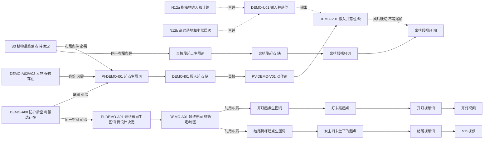

> 【归档】单幅首帧/续接模式的旧规划，未实测。默认流程不读这份，只在走首帧分支时参考。

# 海鸥样品：拿一条生产线就能接手

> 适用边界：历史单幅起点/续接模式的文字规划，未实测。普通多参考默认请先看 [鸽子实战](pigeon-multiview.md)，不要将下文逐线起点图套给每个新单元。

**性质：**基于真实小分镜的完整文字演练，未派发生成、未替换海鸥现行台账。编号 DEMO-U 等仅用于演练。
**本次核验：**原小分镜和下面三份候选输入文件存在。未查看这些原图的画面，也未取得当前有效版本登记，不能把“存在”写成“用户已采用”。
**来源：**[海鸥小分镜](E:/智线出海内容运营/13_内容复盘/YouTube/我的频道全套数据/06_制作对话与决策/20260910_海鸥/小分镜.txt) 的 N11、N12a–e、N13–15；[先前阶段/合并样品](seagull-plant-batch.md) 中的制作记录与待验证选择。历史“一把单人座椅”冲突来自该记录，本轮未重新读取原聊天，不冒充新增核验。
**用途：**先演练 N12a+N12b，一份完整卡带出全部必要信息；其余分支只用于看懂共用关系，不批量改写原片。
**来源台账修订：**DEMO-R01。此文件是样品的唯一台账。

## 看懂这张网

最终需要：同一阳台内两人可坐，木色边桌能放两杯饮品，植物有高低层次，暖灯、防护网和门口通道都保留。座位形式不能凭空从两人需求推定为一把单人椅；具体形式沿实际已确认图，本样品没有替用户选新家具。



```text
N12a + N12b → DEMO-U01
已有空间/人物候选 + 明确植物落点 → 起点生图词 → I01 → 视频词 → V01
同一个植物落点约定              → 桌椅起点图 → 桌椅视频
V01 ┄ 硬切，无尾帧等待 ┄ 桌椅视频

空间依据 A00 + 两人使用布局决定 → 最终布局生图词 → A01
最终布局 A01 ┬→ 灯未亮起点 → 开灯视频
             └→ 持杯未坐下起点 → N15视频
```

S3 现在是布局条件节点，不自动意味着再造一张图；若实际落点难以仅用文字统一，再把唯一共享 S3 图登记为A资产，并将两条线共同引用它。最终布局A01先解决两人坐、桌面、通道等关系；不会要求每个动作上传完成态。

## 小分镜与本样品安排

| 小分镜 | 单元/视频 | 保留什么 | 等什么；不等什么 |
|---|---|---|---|
| N12a 25.60–27.20 + N12b 27.20–28.80 | DEMO-U01 / DEMO-V01 | 男主抱入→Anna让路→高盆放稳→Anna摆小盆 | 等本段起点与落点依据；不拆成搬入/放下两条 |
| N12c | 桌椅分支，沿原项目编号 | 扶桌、调整、留腿部空间 | 共享植物落点和实际座位布局；不等DEMO-V01尾帧 |
| N12e | 开灯分支，沿原项目编号 | 按开关、暖灯亮、理叶 | 等灯未亮起点；不等放靠垫视频 |
| N15 | 结尾分支，沿原项目编号 | 走入、放杯、坐下，后四秒静享 | 等有效终局、持杯未坐下起点与工具时长；不等开灯视频尾帧 |
| N11、N12d、N13、N14及前半片 | 保留原小分镜和已有制作安排 | 不因样品缩范围而漏掉 | 本样品没有改写这些单元；正式全片台账必须覆盖 |

N11 的女主视点、叶片掠入与N12b宽景可能有构图差异，不能为少一条而静默删掉。能从同条素材裁切且保留原表达才复用，否则沿原制作安排。

## 图片台账

| ID | 真实文件/计划位置 | 状态与用途 |
|---|---|---|
| DEMO-A00 | E:/智线出海内容运营/13_内容复盘/YouTube/我的频道全套数据/06_制作对话与决策/20260910_海鸥/07_U01_V4全新资产/P08-A.png | 文件存在、当前是否采用未知；候选空间依据 |
| DEMO-A02 | E:/智线出海内容运营/13_内容复盘/YouTube/我的频道全套数据/06_制作对话与决策/20260910_海鸥/人物_Anna_完整卡_当前真源.png | 文件存在、有效性登记待接入；身份候选 |
| DEMO-A03 | E:/智线出海内容运营/13_内容复盘/YouTube/我的频道全套数据/06_制作对话与决策/20260910_海鸥/亚洲男性三视图.png | 文件存在、有效性登记待接入；身份候选 |
| DEMO-A01 | 尚无采用文件；最终布局节点 | 两人使用容量及共享布局先沿项目确认；缺时由唯一负责人准备 |
| DEMO-I01 | 见下方完整卡的计划绝对路径 | 尚未生成；搬入起点，不是植物已经全部摆好 |
| DEMO-V01 | 见下方完整卡的计划绝对路径 | 尚未生成；提示词草稿已给齐 |

本样品候选历史文件未改名、不为示范复制一遍图片。正式采用旧文件时固定其已登记版本；如果旧文件可能被原地覆盖，先在项目内保存不可覆盖的新版本引用。

## 并行安排（条件演练，没有实际开任务）

容量未知先两路。A处理植物起点/视频；B处理终局共用布局的缺口，随后准备能解锁桌椅/开灯/结尾的起点。最终布局不清时A只在其植物落点已定且不受家具决策影响的范围先做，不能明知落点会被家具挤占仍标就绪。
若终局和本段输入本来已齐，B可直接做开灯。第三路只有在容量明确且确有独立就绪任务时使用。图和视频都占制作名额，同一共用图不派给两处。

## 完整生产单元卡｜DEMO-U01

以下“复制开始”到“复制结束”可整段交给新对话，独立保留动作、输入、缺口、正文和失败处理。路径预留不代表文件或目录已创建。

<!-- 复制开始 -->

# DEMO-U01｜植物搬入并落位

总台账：C:/Users/Administrator/.codex/skills/adaptive-video-production/examples/seagull-ledger.md
来源修订：DEMO-R01｜卡版本：v01｜性质：文字演练、尚未派发。
原分镜来源：E:/智线出海内容运营/13_内容复盘/YouTube/我的频道全套数据/06_制作对话与决策/20260910_海鸥/小分镜.txt，N12a、N12b。
任务：防护完成且尚未美化的同一阳台，男主人抱高盆植物进入，Anna让路；男主放稳高盆，Anna放置低盆，形成高低层次，门口到座位的通道空出。
范围：只处理这组，不改全片。素材合计服务成片25.60–28.80秒、预算3.2秒；不能把全部动作强塞入生成前1.6秒。
身份、服装、空间尺寸及最终落点沿有效项目依据。女主让路和摆小盆均保留。未到后续阶段的桌椅、靠垫和灯饰不提前出现。
前后采用有效段硬切，不要求植物视频尾帧接桌椅视频。

输入（均为真实存在的候选文件，当前采用版未核实；不是已就绪提交）：
- DEMO-A00：E:/智线出海内容运营/13_内容复盘/YouTube/我的频道全套数据/06_制作对话与决策/20260910_海鸥/07_U01_V4全新资产/P08-A.png；空间底图。
- DEMO-A02：E:/智线出海内容运营/13_内容复盘/YouTube/我的频道全套数据/06_制作对话与决策/20260910_海鸥/人物_Anna_完整卡_当前真源.png；女主人身份。
- DEMO-A03：E:/智线出海内容运营/13_内容复盘/YouTube/我的频道全套数据/06_制作对话与决策/20260910_海鸥/亚洲男性三视图.png；男主人身份。
- 缺口：当前有效版本登记、S3具体植物落点、可用起点、实际生成工具模式与时长选项。先从项目既有记录查，找不到只说明影响提交的具体缺口，不猜版本、不重审用户已接受的图。
- 未确定S3前不擅自把植物放在某一侧；下文“约定落点”提交时应展开成已确定的相对空间位置。

PI-DEMO-I01@v01 生图正文（草稿，补齐上项后可用）：

```text
在提供的同一阳台底图上设置一个动作开始的时刻，保持门窗、栏杆、防护网、空间尺度、已确定的防护道具和傍晚光线，按人物参考保持身份和本阶段服装。
男主人双手抱着较高盆栽站在门口准备进入，Anna站在通道侧边，能够自然让出路线；较矮盆栽放在门内侧可取的位置。用于两盆植物的约定落点暂时留空，门口到座位区的通道保持可走。
这是开始搬入时的单张画面，花盆还未落位。不要提前加入下一阶段的桌椅、靠垫和灯饰。保持能看清搬入路线和落点的中广景，普通手机拍摄观感、自然肤质、正常衣物褶皱、竖屏9:16。
```

起点计划候选绝对路径（尚不存在）：
C:/Users/Administrator/视频生产台账演练/海鸥/素材/候选/DEMO-U01/DEMO-I01_v01.png
用户选用投放路径（尚不存在）：
C:/Users/Administrator/视频生产台账演练/海鸥/素材/可用/DEMO-U01/DEMO-I01_v01.png

若已有起点能支持全部动作，直接登记引用，不重生。多图生图参考能力须先核实；不能虚构额外图槽位。

PV-DEMO-V01@v01 视频正文（起点可用后提交）：

```text
同一阳台中广景连续拍摄，普通手机记录感，保持参考起点的人物、服装、光线和空间布局。
男主人稳稳抱着高盆植物进入，Anna自然让出通道。他顺势走到约定的植物落点，将花盆放稳后松手。与此同时，Anna取来门内侧原有的小盆植物，放在约定的低盆位置，形成前低后高的层次。两人短暂看一眼摆放结果。
动作自然连贯，不在仍抱着花盆时故意停止。保持通道可走，花盆不凭空出现，不新增桌椅或后续装饰。脚步、叶片擦动和花盆落地声跟随接触发生，无对白和额外高潮音效。
```

上传：本段有效起点DEMO-I01的指定版本放实际首帧位。若模式只有单图，人物先落实在该图；不强行上传全套阶段图。
生成时长：未知，按实际工具可选档位选择容纳完整动作的时长并登记；不沿用旧记录的固定4秒。
视频计划候选绝对路径（尚不存在）：
C:/Users/Administrator/视频生产台账演练/海鸥/素材/候选/DEMO-U01/DEMO-V01_v01.mp4
用户选用投放路径（尚不存在）：
C:/Users/Administrator/视频生产台账演练/海鸥/素材/可用/DEMO-U01/DEMO-V01_v01.mp4

剪辑：从同一素材取“进入和让路”“放稳及形成层次”的有效内容，合计3.2秒。去无信息空档，必要时适度加速并配接触声；若保留全部动作仍无法读懂，只报告这组的时长冲突，不默默删Anna动作、延长46秒全片或缩短N15后四秒。
失败处理：
- 起点没有可取的小盆/路线堵塞：只修I01，新版本v02，不据此把“搬入→放下”拆两条。
- 仅小盆动作失败：保留V01中可用搬入落地片段，条件触发补拍新V编号的小盆动作，仍归本单元并保留N12b映射；未触发前不安排多一条视频。
- 输出桌椅提前出现或主景落点关键冲突：先比较局部修本段与共享改版，只报告有关单元；不改其他人的共享图。
- V01最后姿态不好接下一段：保留可用视频，桌椅段按共同落点独立起步、硬切，不自动求尾帧。

新对话执行句：
只按本卡接手DEMO-U01；这是演练样品，准备与说明可以直接做，实际生成须有用户针对项目的执行授权。先读来源台账本单元及相关输入记录；未获得当前有效版本前保持草稿。可用目录中用户按约定投放的文件视为接受，不追加AI审核。不要重规划全片，不覆盖共享台账/图片。若文件不可读，指出具体输入缺口；不得假称图已就绪。
回传：DEMO-U01｜输入ID@版本｜结果路径｜用户已接受/待选用｜可取内容｜偏差影响哪些单元｜下一步唯一动作。

<!-- 复制结束 -->

## 一次实际偏差该怎样记（假设演练）

C01：假设植物V01中Anna只完成让路，未摆低盆；用户接受“搬入和高盆落地”这部分。
判断：缺了N12b中的小盆动作，但不因此否定其余素材；尚无证据要求改共享落点。
处理：保留DEMO-V01_v01，条件新增DEMO-V02用于低盆落位，N12b映射到V01+V02；I01和其他U不重编号。
如果桌椅段依约定完整植物布局单独做，它不必等这条补拍；只有它实际使用V01截帧且截帧缺低盆时才换自己的输入。
更新：台账DEMO-R02与DEMO-U01卡；桌椅段如受输入影响才刷新其卡。下一步只补低盆动作起点/正文，不重做搬入视频。
这是假设偏差测试，不是声称已经发生的新生成失败。

## 怎么用样品完成一次真实任务

选择当前项目里一组**尚未制作**的搬入和落位，将本卡ID、路径、采用版本、已定落点及真实工具选项换成项目实际值，放进该项目唯一台账；已有原素材继续保留。
把完整卡复制给新对话，观察它能否不用重问全片背景，直接给出当前缺口及可执行图/视频内容。用户将选中的素材按约定放入可用路径，该对话下次继续时只登记对应版本和结果。
记录一次：是否少问背景、等待时另一条线能否推进、是否错用图、能否剪进原预算。通过后才扩大到其余未制作内容。

已完成的是输入文件存在核对、具体路径和提示词样品；未完成的是新图/视频生成、剪辑、真实新对话生产及节省时间验证。未来拖拽画布、预览、自动监听、API均未开发。
