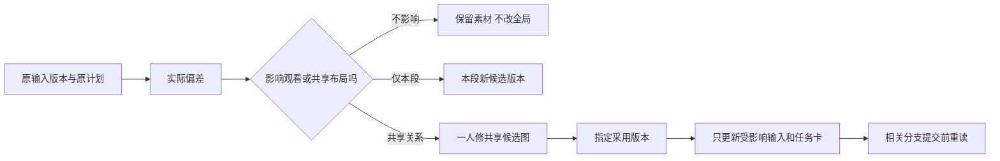

# 实际偏差：只改受影响的部分

这是发生问题时放进总台账的一条短记录，常规生成不另开文件、不走一遍审批。
如只改本段姿势，两三行足够；共享改版才展开影响范围。

- **变更编号/来源：**{{C01；用户反馈或实际文件；没看过就不称已核验}}
- **原计划 → 实际：**{{两句话}}
- **是否影响观看任务/共用布局：**{{不影响/仅本段/共享；为什么}}
- **受影响：**{{单元ID与具体输入关系、可见冲突}}；**不受影响：**{{无需逐个穷举，用范围即可}}
- **保留什么：**{{已用视频、旧版本}}；**新候选：**{{新路径@版本；不覆盖旧文件}}
- **采用与通知：**{{谁已决定采用；待决定项；总台账R版本；相关任务卡是否刷新/对话待重读}}
- **下一步唯一动作：**{{谁做什么}}

处理规则：

1. 台账“设计布局”不因为生成结果随机漂移而自动变化。用户接受一个局部视频，也不自动表示接受它改写共享布局。
2. 原地不覆盖文件，ID不变、版本增加。新内容追加ID；弃用项标“停用/被谁替代”，不删除旧映射或给全片重排号。
3. 新版替代只沿真正材料依赖查下游；剪辑硬切、仅供参考连线不自动传播重做，但可见状态冲突仍须判断。
4. 尚未提交且受影响的换输入；正在生成的记住所用旧版，结果回来再看可取部分；已接受素材只处理具体可见冲突。暂停不等于撤销已发出的生成请求。
5. 用户按指定可用路径投放新文件即接受该文件。新共享版本是否替代旧版，按其明确替换指示或已约定的采用规则登记；多个候选不能按时间最新擅选，暂停相关提交并只解决版本歧义。
6. 同一共用图只设一个修改负责人。单元对话不直接覆盖总台账；总控合并短回传并同步该项图与任务卡。其他分支继续。
7. 建议合并前发现其中一段已单独提交/可用，按实际进度保留该请求和产物；另一段作为原U的补足V，或沿用项目既有U映射。不为符合新合并方案重做已发素材，剩余动作仍保留。例：压垫已生成，开灯尚未做，就只补开灯，不再生成压垫加开灯的整条。
8. 同一单元被拆为两条补拍：保留U编号、旧V及可用片段，追加V编号和原分镜映射；确需新U时记录“替代/补足哪个U”，不丢已确认动作。
