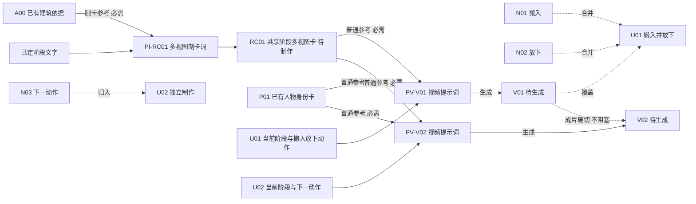

# {{项目名}}｜生产台账

> 这是项目唯一有效进度入口；已有进度文件就升级原文件，不另建第二份总控。
> 项目根目录：{{真实绝对路径}}｜台账修订：R01｜更新日期：{{日期}}｜维护者：{{总控}}
> 原小分镜：{{路径及有效版}}｜计划：草案/用户已确认｜生成工具/模式/时长选项：{{已知值或具体未知}}
> 图是台账关系的视图；修改时同步相关节点和任务卡，不靠聊天记忆。
> 批次冻结时写明前5秒来源、用户最新确认、替代的旧方案与仍未决定项；工作对话按本修订接手，不各自重读全部聊天作版本判断。

## 先看最后要做成什么

**最终使用画面：**{{谁如何使用空间、容量、主要布局、必须传达的感受}}
**不能改：**{{已确认动作、总时长、必要停留、关键功能}}
**仍待决定：**{{只写影响制作的缺口；没有则删掉}}
**阶段路线：**{{S0已有状态 → S1必要变化 → S2终局；阶段数不是图数}}

## 一眼看懂生产网

下面只是语法样例，实例化时替换成真实编号和关系，删除不适用的示范节点。图多时先给全局简图，再按生产线分组；每条真实制作依赖都必须能在对应分组看见。



**读图：实线是材料生产依赖；虚线是归属、剪辑或参考说明，不拿来计算谁等谁。**小分镜到单元的“归入/合并”统一用虚线，它是映射，不是等待关系。图片只在真实用作另一张图的输入时连生成依赖，不能仅因同一场景就把图片排成串。

Mermaid 不能显示时，保留这一种备用读法（实例化时与上图一致）：

```text
N01 + N02 → U01
已有建筑 A00＋阶段设计 D → 制卡词 PI-RC01 → 多视图卡 RC01
RC01＋P01＋U01当前阶段/动作 → 视频词 PV-V01 → V01
RC01＋P01＋U02当前阶段/动作 → 视频词 PV-V02 → V02（N03归入U02）
V01 ┄ 成片硬切（不等待）┄ V02
```

共享卡已存在时跳过制卡操作，不为每组新增首帧。真需首帧时另画“已有图/局部构图词→单幅I01→视频”，多视图卡不直接占首帧位。真需动作续接才登记“V01指定版本/时间点→F01截帧→PV-V02”；已有F01直接用。目标仅供阅读用虚线；真实必需参考缺失仍是输入缺口。此图RC01待制作，因此两组视频等RC01，制卡词和视频正文可先准备，不能写成视频现在即可提交。

## 小分镜如何落到素材

| 小分镜/成片位置 | 保留/合并/可选/不生成及可见理由 | 生成单元与必须保留的动作/情绪 | 阶段变化、预期可剪内容及工具时长依据 | 输出视频 | 所需图（有效/缺口） | 当前可做/卡点/负责人 |
|---|---|---|---|---|---|---|
| {{N编号和时长}} | {{一眼可见的新信息，或为何不拍}} | {{U编号与保留动作}} | {{不是倒填工具档位；情绪/功能停留同样计入}} | {{V编号；可多个}} | {{ID与用途}} | {{先做图/可提交视频/排队等}} |

一个视频可以覆盖多个小分镜；一个单元必要时也可输出多个视频。失败后补拍一个动作，只追加映射，不丢掉其余已用内容、不重新编号全片。交付前每个保留的小分镜必须有去处，跳过的写可见理由；长视频不按15秒凑满。

## 图片和引用关系

资产 ID 是稳定身份；v01 是一次具体文件。下面所有候选路径均须显式标“计划路径，尚不存在”。

| ID/职责/服务单元 | 状态及依据 | 当前有效版本与绝对路径 | 必需父输入/仅供参考 | 谁制作/缺口 |
|---|---|---|---|---|
| {{RC01 共用阶段多视图卡}} | {{用户已接受/存在未采用/待制作}} | {{v01 + 路径或无}} | {{输入ID@版本、借用职责}} | {{唯一负责人；来源→制卡词→命名}} |
| {{P01 人物身份卡}} | {{状态}} | {{路径或缺口}} | {{身份依据；不锁当前动作}} | {{已有复用/必要视角待补}} |

已有原文件名可原样登记，无须复制或改名。人物身份、建筑、当前阶段、材料/目标分别写清；只有实际需要才加局部构图、视频首帧或续接帧行。卡可带短中文标注，格数/画幅不固定，不等同一张单幅9:16起点照。
本次上传只选模式支持且本段需要的图，不把整个资产库上传。

## 提示词、输出与落盘约定

| 输出 ID/所属单元 | 提示词 ID 与位置（含版本） | 输入槽位及指定图版本 | 计划输出绝对路径 | 实际可用文件/生成时长/剪辑取用 |
|---|---|---|---|---|
| {{RC01/共享}} | {{PI-RC01@v01；正文位置，确需制卡时}} | {{建筑图A00@v01＋已定阶段文字}} | {{路径；未生成}} | {{未生成或用户接受依据}} |
| {{V01/U01}} | {{PV-V01@v01；位置}} | {{普通参考RC01@v01＋P01有效版；当前动作写入正文}} | {{路径；未生成}} | {{素材秒数与成片秒数分开；未知参数标待确认}} |

文件约定以 [交给自动生产程序](../references/auto-production-table.md) 第 1 节为准：
- `生成\RC01_名称_v01.png`、`生成\U01_v01.mp4`：程序生成的正式结果；`生成\_待审` 不作为正式参考。
- `共用卡制卡词.md`：全部图片任务；`单元\U01.md`：每条视频的任务卡；`说明\`：分析与历史；`导入核对清单.md`：每次交付必交。
- 单幅I图仅在具体条件需要时创建，也作为 RC 任务写进 `共用卡制卡词.md`。
- 派生截帧 `F01_v01.png` 登记来源视频 ID、版本及实际截帧时间点。
- 未生成的路径可以提前预留，但不能称为已有输入；扩展名按真实输出，不只改后缀伪装格式。

## 本批安排

**活跃制作上限：**{{默认最多3；容量未知先2，含制作图片；总控亲自制作也占位}}
**可用目录约定：**{{用户投放代表接受；候选不自动接受；无需新增AI验收}}
**当前批次：**{{对话A → 哪条线；对话B → 哪条线}}
**排队：**{{已就绪但无名额}}；**真正等待：**{{具体缺图/截帧/设置，不写笼统等上一条}}

共享图只指定一位制作者。执行中的任务保留所用版本；各分支不改总台账。
文件不会自动通知所有对话：每次开始/恢复/提交前，只读取当前单元和相关资产记录，核对版本、输入文件和设置；不用重读全部历史，不重复审素材画面。

## 人工只看这几个关系点

首次新计划展示一次：动作有无遗漏、该合并的是否合并、最终布局是否说得通、共用图/真续接关系是否正确。用户已确认的直接复用。局部缺口只暂停相关任务；无关已授权任务继续。

## 实际结果与计划不同

把 [变更短记录](production-change-log.md) 的必要字段放在本文件末尾，只在发生偏差时追加。
采用新版本只更新受影响节点、相关连线和已派发单元卡；不动其他编号、已用素材和无关分支。
每次修订写“R02：I01换v02，仅U01；已通知/待重读哪个对话”。单元卡是带版本的执行快照，不是第二份全片进度。
