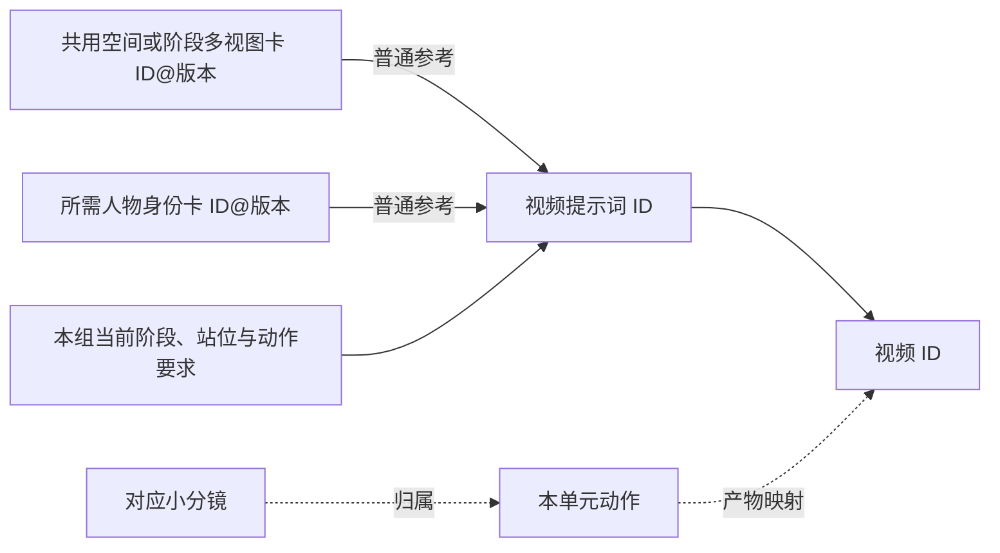

# {{U编号}} 说明｜{{生产线名称}}

> 程序不读本文件。放在 `项目文件夹\说明\{{U01}}_说明.md`。程序读取的任务卡是 `单元\{{U01}}.md`（只有五行头部和“拼好的完整正文”）。
> 项目快照：{{快照路径}}｜快照版本：{{R编号}}｜总台账：{{路径}}｜对应任务卡版本：{{v01}}
> 共享块以快照为准，任务卡正文拼接时原文照贴。规则见 [文件驱动生产](../references/file-driven-production.md)。

## 这条线一眼看懂



普通多参考默认：共用卡直接到视频，不经过逐组首帧。实例化时只保留实际需要的输入。首帧/续接只在实际条件成立时加入，并说明来源、操作、命名和真实槽位。

**前因 → 动作 → 后果：**{{足以独立理解，不写“同上”}}
**对应原分镜/阶段：**{{编号、内容、成片位置}}
**观看价值与单元决定：**{{必须让观众看见什么；原分镜哪些保留、合并、可选或不生成；不可删的情绪/功能停留}}
**必须保留：**{{动作、情绪、硬时间、可见关键布局}}
**可局部调整：**{{人物起点、机位等}}；**需总控处理：**{{共享家具/设施等}}
**与前后段：**{{硬切不等待；或具体动作续接及理由}}
**本批有效修订：**{{台账R号；用户最新确认覆盖了哪条旧草案}}
**空间合同（换机位/安装/跨内外单元必填；纯同机位布置可删）：**
- 锚点：{{2–4 个不变的原建筑}}
- 关系：{{新件在锚点哪一侧、附着于谁}}
- 状态：{{起点 → 谁接触改变什么 → 终点仍没有什么}}
- 证据视点：{{哪个镜头证明功能}}
**台词/旁白（有才填）：**{{原文；估算说话秒数＋动作余量；语气/重音/停顿；嘴部回避构图或画外音}}

## 输入与缺口

| 上传序号 | 素材名称 | 准确路径（与任务卡上传顺序逐字一致） | 职责 | 已有/上游 RC 任务 | 存在性 |
|---|---|---|---|---|---|
| 1 | {{人物身份}} | 项目文件夹\{{人物参考.png}} | {{身份}} | 已有 | {{已核对存在/待核对存在性}} |
| 2 | {{空间参考}} | 项目文件夹\生成\{{RC02_空间参考_v01.png}} | {{空间/当前阶段}} | {{RC02@v01}} | 计划路径，由 RC02 生成 |

涉及安装/跨机位/功能证据时，逐张看本次实际上传图是否与空间合同显著冲突，不以“只借局部”自动放行。

**工具与时长：**{{自然动作/必要停留与可剪内容估算 → 选定时长；**时间轴必须从 0.0 秒铺满到生成时长的最后一秒**，写不满的那几秒模型会自己编走位}}
**输入冲突与真实感：**{{有冲突先解决输入}}
**视频取用：**{{成片位置、取用秒数、关键动作、硬停留与声音}}
**声音计划：**{{可见动作→同步声→低环境底声；情绪停留是否需要无歌词纯音乐}}
**动作续接（没有则删）：**{{来源视频ID@版本、时间点、F编号}}

## 本单元专属部分（子任务只写这些，再拼进任务卡正文）

- 阶段起止：{{起点状态 → 终点状态；终点仍没有什么}}
- 动作与接触：{{谁接触何物，产生什么可见变化}}
- 时间安排：{{0–2 秒…；总长不超过生成时长}}
- 镜头：{{机位、景别、内部切镜}}
- 动作音效：{{可见动作 → 同步声}}
- 负向约束：{{本单元相关的已知坑 K__}}

## 生产状态依据与未决问题

**当前状态：**{{定稿/草稿}}（与任务卡一致）
**依据：**{{用户何时批准纳入本次生产；或尚待确认什么}}
**未决问题：**{{无 / 逐条写具体缺口、冲突和解除条件}}
**历史说明：**{{已解除的旧限制写在这里并标“历史”，不留在任务卡}}

## 结果偏离时，只处理哪里

{{具体失败 → 保留什么 → 修哪一处 → 影响哪个输入/单元}}
发生共享变更时提交候选，不覆盖旧图、不自行改全片布局。

**待总控（发现快照有问题时写这里，不自己改快照）：**{{无 / 具体问题与建议}}

**版本记录：**

| 版本 | 改了什么 | 为什么 | 是否已提交过 | 依据快照 | 由谁改 |
|---|---|---|---|---|---|
| v01 | 初稿 | — | 否 | R01 | 写词子任务 G{{}} |

## 复制给新对话

复制本说明和 `单元\{{U01}}.md` 全文，加下面一句：

```text
按项目快照、这份单元说明和单元卡，用 adaptive-video-production 接手，只负责这个单元，保留已完成内容。
共享块原文照贴，不改写；只写本单元专属部分，拼好后写回 单元\U__.md 的“拼好的完整正文”，分析和版本记录写回本说明。
单元卡格式按 references/auto-production-table.md 第 3 节，不加别的内容。
缺什么明确指出；不覆盖共用图或总台账；需要改变共用布局时回传具体影响。
```

## 回传

```text
U__｜本卡版本__｜使用输入ID@版本__｜结果路径__｜用户已接受/待用户选用__
可取内容__｜实际偏差及影响单元__（无则写无）｜下一步唯一动作__
```
